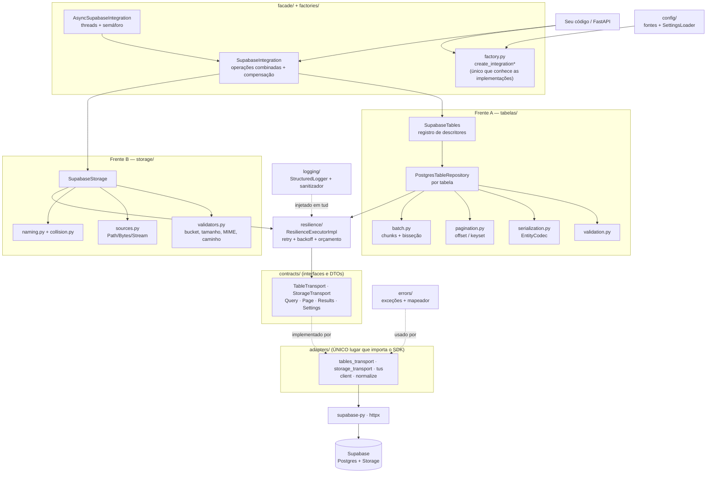
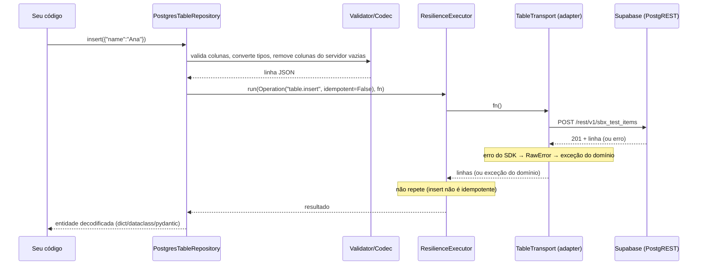
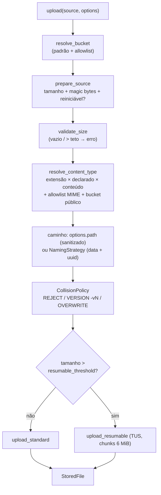

# Guia de uso — integração Supabase (`bai_supabase`)

Guia único de uso da integração: **receitas para copiar e colar** (partes 1 a 6), **arquitetura com esquemas** (parte 7) e **referência detalhada** de classes, métodos e parâmetros (parte 8). Quem só precisa usar pode parar na parte 6; quem precisa entender por que algo se comporta de certa forma segue para as partes 7 a 10.

> Escopo: a pasta `supabase/` é **independente** do resto do projeto (`src/`). Nada aqui importa código do backend existente. A integração é **síncrona**; para FastAPI há um wrapper assíncrono (seção 5.3).

## Sumário

1. [Instalação e primeiro uso](#1-instalação-e-primeiro-uso)
2. [Configuração (`.env`)](#2-configuração-env)
3. [Tabelas — CRUD](#3-tabelas--crud)
4. [Buckets — arquivos](#4-buckets--arquivos)
5. [Arquivo + registro, erros e FastAPI](#5-arquivo--registro-erros-e-fastapi)
6. [Receitas rápidas e armadilhas](#6-receitas-rápidas-e-armadilhas)
7. [Arquitetura](#7-arquitetura)
8. [Referência detalhada](#8-referência-detalhada)
9. [Resiliência, logs e segurança](#9-resiliência-logs-e-segurança)
10. [Testes, limitações conhecidas e como estender](#10-testes-limitações-conhecidas-e-como-estender)

---

## 1. Instalação e primeiro uso

### 1.1 Pré-requisitos

- Dependências do projeto instaladas (`uv sync`): `supabase` (SDK oficial), `httpx` e `filetype`.
- Um projeto Supabase com a tabela e o bucket que você vai usar. **A integração não faz DDL** (não cria tabela nem bucket): isso é preparação manual.
- Tabela de exemplo usada neste guia (`sbx_test_items`, também em [tests/support/test_schema.sql](tests/support/test_schema.sql)):

```sql
create table if not exists public.sbx_test_items (
  id uuid primary key default gen_random_uuid(),
  name text not null,
  qty integer default 0,
  bucket text,
  path text,
  created_at timestamptz not null default now()
);
alter table public.sbx_test_items enable row level security;  -- acesso só pela chave secret do backend
```

### 1.2 Import: o detalhe do `sys.path`

O pacote é `bai_supabase`, dentro de `supabase/`. A pasta `supabase/` **não tem `__init__.py`** de propósito (para não sombrear o SDK `supabase`). Portanto o que entra no `sys.path` é a **pasta `supabase/`**, nunca a raiz do repositório:

```python
import sys
from pathlib import Path

sys.path.insert(0, str(Path(__file__).resolve().parent))  # se o script está em supabase/
# ou, de fora da pasta:  sys.path.insert(0, "supabase")
```

### 1.3 Primeiro script (copie, preencha o `.env` e rode)

```python
import sys
from pathlib import Path
sys.path.insert(0, str(Path(__file__).resolve().parent))

from bai_supabase import (
    create_integration_from_env, TableDescriptor,
    Query, Condition, Op, PageRequest, Sort,
    BytesSource, PathSource, StreamSource, UploadOptions, CollisionPolicy,
)
from bai_supabase.contracts import FilterGroup, BatchOptions
from bai_supabase.errors import (
    SupabaseIntegrationError, RecordNotFoundError, FileAlreadyExistsError, ValidationError,
)

sb = create_integration_from_env(
    dotenv_path=".env",                       # só dev; em homol/prod use variáveis da plataforma
    descriptors=[
        TableDescriptor(
            "sbx_test_items",
            columns=("id", "name", "qty", "bucket", "path", "created_at"),  # allowlist de colunas
            server_managed_columns=("id", "created_at"),                    # o servidor preenche
            sort_key="created_at",                                          # habilita paginação keyset
        )
    ],
)
items = sb.tables.table("sbx_test_items")   # repositório da tabela
print(items.insert({"name": "Ana", "qty": 1}))
```

`create_integration_from_env` lê as variáveis `SBX_*`, valida tudo e **falha cedo** com um `SettingsError` que lista só os **nomes** de variáveis ausentes/inválidas (nunca valores).

Scripts prontos no repositório: [sb_crud.py](sb_crud.py) (tabelas) e [sb_bucket.py](sb_bucket.py) (bucket).

---

## 2. Configuração (`.env`)

Mínimo para funcionar:

```dotenv
SBX_URL=https://<ref-do-projeto>.supabase.co
SBX_SECRET_KEY=sb_secret_...            # chave SECRET do backend (nunca no frontend)
SBX_BUCKET_DEFAULT=meu-bucket           # só se for usar arquivos
SBX_TABLES_ALLOWLIST=sbx_test_items     # tabelas permitidas (OBRIGATÓRIA em prod)
SBX_BUCKETS_ALLOWLIST=meu-bucket        # buckets permitidos (OBRIGATÓRIA em prod)
```

Regras que costumam causar erro de configuração:

| Regra | Efeito |
|---|---|
| `SBX_URL` deve ser `https` (http só para `localhost` em `dev`), sem credenciais/query | `SettingsError` |
| `SBX_SECRET_KEY` que comece com `sb_publishable_` é recusada | `SettingsError` |
| `SBX_ENV=homol` ou `prod` **proíbe** arquivo `.env` (`dotenv_path`) | `SettingsError` em `SBX_ENV` |
| `SBX_ENV=prod` exige `SBX_TABLES_ALLOWLIST` e `SBX_BUCKETS_ALLOWLIST` | `SettingsError` (ausentes) |
| `SBX_BUCKET_DEFAULT` deve constar em `SBX_BUCKETS_ALLOWLIST` (se esta existir) | `SettingsError` |
| `SBX_EXPECTED_PROJECT_REF` deve casar com o subdomínio de `SBX_URL` | `SettingsError` (protege contra apontar para o projeto errado) |
| Valor vazio conta como **ausente** | usa o padrão |
| Tabela nova precisa de `TableDescriptor` **e** estar na `SBX_TABLES_ALLOWLIST`; bucket novo precisa estar em `SBX_BUCKETS_ALLOWLIST` (ou ser o padrão) | `ConfigurationError` / `ValidationError` |

A lista completa e comentada está em [.env.example](.env.example); os principais grupos e padrões:

| Grupo | Variáveis (padrão) |
|---|---|
| Ambiente | `SBX_ENV` (`dev`), `SBX_DB_SCHEMA` (`public`), `SBX_EXPECTED_PROJECT_REF` |
| Rede/retry | `SBX_HTTP_TIMEOUT_SECONDS` (10), `SBX_HTTP_CONNECT_TIMEOUT_SECONDS` (3), `SBX_RETRY_MAX_ATTEMPTS` (3, **total** de tentativas), `SBX_RETRY_BACKOFF_BASE_SECONDS` (0.5), `SBX_RETRY_BACKOFF_MAX_SECONDS` (8), `SBX_RETRY_BUDGET_SECONDS` (30) |
| Tabelas | `SBX_TABLES_DEFAULT_PAGE_SIZE` (50), `SBX_TABLES_MAX_PAGE_SIZE` (min(1000, server max rows)), `SBX_TABLES_BATCH_SIZE` (500), `SBX_TABLES_SERVER_MAX_ROWS` (1000 — o `max-rows` real do seu projeto) |
| Arquivos | `SBX_STORAGE_MAX_FILE_BYTES` (50 MiB), `SBX_STORAGE_ALLOWED_MIME` (vazio = qualquer; aceita `image/*`), `SBX_STORAGE_SIGNED_URL_TTL_SECONDS` (300), `SBX_STORAGE_SIGNED_URL_MAX_TTL_SECONDS` (3600), `SBX_STORAGE_RESUMABLE_THRESHOLD_BYTES` (6 MiB), `SBX_STORAGE_RESUMABLE_CHUNK_BYTES` (6 MiB), `SBX_STORAGE_MEMORY_CAP_BYTES` (32 MiB), `SBX_STORAGE_LIST_PAGE_SIZE` (100), `SBX_STORAGE_DELETE_BATCH_SIZE` (100), `SBX_STORAGE_MAX_CONCURRENT_TRANSFERS` (4), `SBX_BUCKETS_PUBLIC` |
| Log | `SBX_LOG_LEVEL` (dev `DEBUG` / homol `INFO` / prod `WARNING`), `SBX_LOG_COLOR` (`auto`; prod `off`), `SBX_LOG_FORMAT` (`pretty`; prod `json`), `SBX_LOG_SLOW_MS` (1000), `SBX_LOG_MAX_FIELD_CHARS` (200) |

Observações:
- `SBX_PUBLISHABLE_KEY` e `SBX_DB_CONNECTION_STRING` são lidas mas **reservadas/ignoradas** na v1 (a segunda gera aviso).
- `SBX_STORAGE_UPSERT_DEFAULT` é lida e validada, mas **não é aplicada** pelo storage hoje: sobrescrever é sempre explícito via `CollisionPolicy.OVERWRITE`.
- Variáveis `SBX_*` desconhecidas geram aviso (erro de digitação?).
- Os nomes `SBX_*` são independentes dos `SUPABASE_*` da integração antiga. Existe um fallback legado opcional só para `dev` (seção 8.9).

---

## 3. Tabelas — CRUD

Todo exemplo abaixo usa `items = sb.tables.table("sbx_test_items")`.

### 3.1 Create

```python
novo = items.insert({"name": "Ana", "qty": 1})          # devolve a linha gravada, já com id/created_at
print(novo["id"])

lote = items.insert_many(                                # lote: resultado por item
    [{"name": f"item-{i}", "qty": i} for i in range(25)],
    BatchOptions(batch_size=10, mode="continue"),        # "continue" (padrão) ou "stop"
)
print(lote.total, lote.succeeded, lote.failed, lote.all_ok, lote.stopped_early)
for it in lote.items:                                    # ItemOutcome: index, ok, entity, error
    if not it.ok:
        print("falhou o item", it.index, type(it.error).__name__)
```

### 3.2 Read

```python
# por chave primária — RecordNotFoundError se não existe
um = items.get_by_id(novo["id"])

# filtro simples — [] se nada (nunca erro por vazio)
achados = items.find(Query.where(Condition("name", Op.ILIKE, "an%")))
iguais = items.find(Query.eq("qty", 5))

# filtro composto + ordenação + página com contagem
q = Query(
    filter=FilterGroup(items=(
        Condition("qty", Op.GTE, 5),
        FilterGroup(items=(Condition("qty", Op.EQ, 7), Condition("qty", Op.EQ, 9)), logic="or"),
    )),                                                  # qty >= 5 AND (qty = 7 OR qty = 9)
    sorts=(Sort("name"),),                               # Sort("qty", descending=True) para decrescente
    columns=("id", "name", "qty"),                       # projeção (opcional)
)
pag = items.list(q, PageRequest(limit=10, offset=0, include_count=True))
print(pag.items, pag.total, pag.has_more)

# varredura de tabela grande, uma página em memória por vez
for linha in items.iterate(q, page_size=100):
    ...
```

**Keyset (paginação por cursor)** — recomendada para páginas profundas; exige `sort_key` no descritor:

```python
from bai_supabase.tables import KEYSET_START

cursor = KEYSET_START                         # abre a cadeia
while cursor:
    pag = items.list(Query(), PageRequest(limit=100, cursor=cursor))
    for linha in pag.items:
        ...
    cursor = pag.next_cursor                  # None na última página
```

### 3.3 Update

```python
atual = items.update(novo["id"], {"qty": 5})                                  # RecordNotFoundError se não existe
n = items.update_where(Condition("name", Op.LIKE, "item-%"), {"bucket": "x"}) # nº de linhas afetadas
items.upsert({"id": novo["id"], "name": "Ana", "qty": 999}, on_conflict="id") # insere ou atualiza
items.upsert_many([{"id": ..., "name": "A"}, {"id": ..., "name": "B"}], on_conflict="id")
```

### 3.4 Delete

```python
r = items.delete(novo["id"])                              # idempotente
print(r.removed, r.removed_count)                         # removed=False se já não existia
items.delete_where(Condition("name", Op.LIKE, "item-%"))  # filtro VAZIO é recusado (ValidationError)
```

### 3.5 Entidades tipadas (opcional)

Por padrão as linhas são `dict`. Para `dataclass` ou classe estilo Pydantic, informe `model` no descritor:

```python
from dataclasses import dataclass
from datetime import datetime
from uuid import UUID
from typing import Optional

@dataclass
class Item:
    id: UUID
    name: str
    qty: int = 0
    created_at: Optional[datetime] = None

sb = create_integration_from_env(
    dotenv_path=".env",
    descriptors=[TableDescriptor("sbx_test_items", model=Item, server_managed_columns=("id", "created_at"))],
)
items = sb.tables.table("sbx_test_items")
novo = items.insert(Item(id=None, name="Ana", qty=1))   # id=None é omitido (coluna do servidor)
outro = items.get_by_id(novo.id)                        # insert/upsert aceitam Item ou dict; leituras devolvem Item
# update(id, {...}) recebe sempre um dict de alterações (ou, em Pydantic, o modelo com exclude_unset)
```

---

## 4. Buckets — arquivos

### 4.1 Upload

```python
st = sb.storage.upload(
    BytesSource(b"conteudo", filename="nota.txt", content_type="text/plain"),
    UploadOptions(folder="docs"),               # caminho gerado: docs/AAAA/MM/<uuid>.txt
)
print(st.bucket, st.path, st.size, st.upload_mode, st.content_type, st.original_name)

# arquivo grande: lido em stream; acima de 6 MiB o upload vira resumable (TUS) automaticamente
grande = sb.storage.upload(
    PathSource("video.mp4", content_type="video/mp4"),
    UploadOptions(folder="videos"),
)

# stream (ex.: UploadFile do FastAPI): informe o tamanho se souber
with open("relatorio.pdf", "rb") as f:
    sb.storage.upload(StreamSource(f, size=..., filename="relatorio.pdf", content_type="application/pdf"))

# colisão: REJECT (padrão) | VERSION (caminho novo -vN) | OVERWRITE (explícito)
sb.storage.upload(
    BytesSource(b"v2", filename="a.txt", content_type="text/plain"),
    UploadOptions(path=st.path, collision=CollisionPolicy.VERSION),
)
```

O upload **valida antes de ir à rede**: bucket permitido, tamanho (vazio e acima do teto são recusados), extensão × MIME declarado × conteúdo real (magic bytes) e a allowlist de MIME.

### 4.2 Read

```python
dados = sb.storage.download(st.path)                     # bytes (limitado pelo teto de memória, 32 MiB)
sb.storage.download_to(grande.path, "saida/video.mp4")   # stream direto para disco (use para arquivos grandes)
url = sb.storage.signed_url(st.path, ttl_seconds=300)    # URL assinada (teto 3600 s; acima → ValidationError)
pub = sb.storage.public_url(st.path, bucket="publico")   # só para bucket listado em SBX_BUCKETS_PUBLIC
existe = sb.storage.exists(st.path)
pagina = sb.storage.list(prefix="docs", limit=100)       # Page[ObjectInfo]
for o in pagina.items:
    print(o.path, o.size, o.content_type, o.updated_at, o.is_folder)
```

### 4.3 Delete

```python
rep = sb.storage.delete([st.path, grande.path])          # idempotente; relatório por caminho
print(rep.requested, rep.removed, rep.failed)            # failed: {caminho: motivo}
sb.storage.delete_prefix("docs/2026/11")                 # DESTRUTIVO: apaga tudo sob o prefixo (recursivo)
```

> Falhas parciais em `delete` **não levantam exceção**: confira `rep.failed`.

---

## 5. Arquivo + registro, erros e FastAPI

### 5.1 Operações combinadas (com compensação)

```python
r = sb.save_file_with_record(
    "sbx_test_items",
    BytesSource(b"pdf...", filename="contrato.txt", content_type="text/plain"),
    lambda f: {"name": "contrato", "bucket": f.bucket, "path": f.path},   # monta o registro a partir do arquivo gravado
    UploadOptions(folder="contratos"),
)
r.raise_if_failed()                    # levanta o MESMO erro original, se houve falha
print(r.status.value, r.record["id"])  # "completa" | "parcial" | "falhou"

# substituir o arquivo (caminho novo; o antigo só é apagado por último)
sb.replace_file_in_record(
    "sbx_test_items", r.record["id"],
    BytesSource(b"v2", filename="contrato.txt", content_type="text/plain"),
    lambda f: {"bucket": f.bucket, "path": f.path},
    old_ref=(r.stored_file.bucket, r.stored_file.path),
)

# apagar registro e arquivo (registro primeiro)
sb.delete_record_and_file("sbx_test_items", r.record["id"], (r.stored_file.bucket, r.stored_file.path))
```

Se o registro falhar depois do upload, a fachada apaga o arquivo sozinha. Se essa limpeza também falhar, o status vira `parcial` e o log registra `orfao_possivel=true`. Veja a tabela de estados na seção 8.6.

### 5.2 Tratamento de erros

```python
try:
    items.get_by_id("00000000-0000-0000-0000-000000000000")
except RecordNotFoundError:
    ...                                   # 404 no seu endpoint
except ValidationError:
    ...                                   # 422: entrada inválida (detectada antes da rede)
except SupabaseIntegrationError as e:     # qualquer erro da integração
    print(e.retryable, e.status, e.provider_code, e.attempts, e.outcome_unknown, e.correlation_id)
```

Nenhuma exceção do SDK (`supabase`, `postgrest`, `storage3`, `httpx`) chega ao seu código: tudo vira `SupabaseIntegrationError` ou subclasse, com a causa original em `__cause__`. Hierarquia completa na seção 8.7.

### 5.3 FastAPI (sem bloquear o event loop)

```python
from contextlib import asynccontextmanager
from fastapi import FastAPI, UploadFile
from bai_supabase import create_async_integration, TableDescriptor, StreamSource, UploadOptions
from bai_supabase.config import SettingsLoader, ChainedSource, EnvironmentSource, DotenvFileSource

DESCRIPTORS = [TableDescriptor("sbx_test_items", columns=("id", "name", "qty", "bucket", "path", "created_at"),
                               server_managed_columns=("id", "created_at"), sort_key="created_at")]

@asynccontextmanager
async def lifespan(app: FastAPI):
    settings = SettingsLoader().load(ChainedSource(EnvironmentSource(), DotenvFileSource(".env")))
    app.state.asb = create_async_integration(settings, descriptors=DESCRIPTORS)
    yield

app = FastAPI(lifespan=lifespan)

@app.post("/itens")
async def criar(nome: str):
    asb = app.state.asb
    repo = asb.sync.tables.table("sbx_test_items")
    return await asb.run(repo.insert, {"name": nome})          # roda em thread

@app.post("/arquivos")
async def enviar(arquivo: UploadFile):
    asb = app.state.asb
    fonte = StreamSource(arquivo.file, filename=arquivo.filename, content_type=arquivo.content_type)
    st = await asb.upload(fonte, UploadOptions(folder="uploads"))   # sem size: a integração copia p/ temporário e valida o teto
    return {"bucket": st.bucket, "path": st.path, "size": st.size}
```

`create_async_integration(settings, **kwargs)` aceita os mesmos `kwargs` de `create_integration` (logger, transports, etc.). Em homol/prod troque a cadeia de fontes por `EnvironmentSource()` apenas.

---

## 6. Receitas rápidas e armadilhas

| Quero... | Faça |
|---|---|
| Registrar outra tabela depois da criação | `sb.tables.register(TableDescriptor("outra", ...))` (e inclua em `SBX_TABLES_ALLOWLIST`) |
| Listar tudo que existe | `items.find()` (carrega **tudo** em memória) — para tabelas grandes use `iterate` |
| Retomar varredura que falhou | capture a exceção, leia `exc.resume_cursor` e chame `items.iterate(q, start_after=exc.resume_cursor)` (só em keyset) |
| Saber se há mais páginas | `pag.has_more` (e `pag.next_cursor` em keyset) |
| Total de linhas | `PageRequest(include_count=True)` → `pag.total` (em keyset só na primeira página) |
| Gerar URL temporária de download | `sb.storage.signed_url(path, ttl_seconds=300)` |
| Subir arquivo sem sobrescrever | padrão (`CollisionPolicy.REJECT`) → `FileAlreadyExistsError` se existir |
| Manter nome legível do arquivo | passe `filename=` (vai como metadado `original_name`; o caminho é gerado) ou injete `PreservedNameNaming` (seção 10.3) |
| Usar tipos `datetime` | sempre com fuso (`datetime.now(timezone.utc)`); sem fuso → `ValidationError` |

Armadilhas frequentes:

1. **Colunas fora da allowlist são recusadas** (leitura, filtro, ordenação e escrita). Se o descritor tem `columns=(...)`, todas as colunas que você usa precisam estar nela — incluindo a PK e a `sort_key`.
2. **Colunas gerenciadas pelo servidor** (`server_managed_columns`) não podem ser escritas: no `insert` valor `None` é omitido, valor preenchido é erro; no `update` são recusadas junto com a PK. A única exceção é o `upsert`, que aceita a coluna usada em `on_conflict`.
3. **`update_where`/`delete_where` com filtro vazio são recusados** (`ValidationError`): proteção contra apagar/alterar a tabela inteira.
4. **Caminhos de objeto só aceitam ASCII `[A-Za-z0-9._-]`**, sem acentos nem espaços, sem segmento começando com ponto, até 8 níveis. Prefira o nome gerado automaticamente e guarde o nome original em `original_name`.
5. **`insert` e `insert_many` nunca são repetidos automaticamente** (não idempotentes). Em timeout o erro vem com `outcome_unknown=True`: confira no banco antes de tentar de novo.
6. **Upload só é repetido pelo executor quando é `OVERWRITE`** (idempotente). Em `REJECT`/`VERSION` um timeout vira `outcome_unknown=True` e o objeto pode ter sido gravado: confira com `exists`.
7. **`exists` devolve `False` também em 401/403** (limitação do SDK): um problema de permissão pode parecer "não existe".
8. **`raise_if_failed()` levanta também em `parcial`**, mesmo quando o registro foi atualizado (por exemplo, falha ao apagar o arquivo antigo). Leia `r.status` antes de decidir.
9. **Nunca chame a integração síncrona dentro do event loop**; use `create_async_integration`.
10. **Em homol/prod não use `.env`**: use `create_integration_from_env()` sem `dotenv_path` (ou o `ChainedSource` só com `EnvironmentSource`).

---

## 7. Arquitetura

### 7.1 Visão geral (camadas)



Versão ASCII (mesma ideia):

```
 seu código ──► factory ──► SupabaseIntegration (fachada)
                             ├── tables  ──► PostgresTableRepository ─┐
                             └── storage ──► SupabaseStorage ─────────┤
                                                                      ▼
                                              ResilienceExecutor (retry/backoff/orçamento)
                                                                      ▼
                                   contracts: TableTransport | StorageTransport (interfaces)
                                                                      ▼
                       adapters/ (único import do SDK) ──► supabase-py / httpx / TUS ──► Supabase
```

### 7.2 Regra de dependência

```
contracts  ◄── tables, storage, resilience, facade   (dependem só de contratos)
errors     ◄── todos
adapters   ──► SDK (supabase, httpx)                  (ÚNICA camada que importa o SDK)
factories  ──► conhece as implementações concretas    (único ponto de composição)
tables ⟂ storage                                      (não se conhecem; só a fachada junta os dois)
```

Essas regras são **verificadas por teste** ([tests/architecture/test_architecture.py](tests/architecture/test_architecture.py)): só `adapters/` importa o SDK; nada importa código de `src/`; só `config/sources.py` toca o ambiente; não há singleton global de configuração.

### 7.3 Fluxo de uma operação de tabela (`items.insert`)



### 7.4 Fluxo de upload (`sb.storage.upload`)



### 7.5 Pipeline de erros

```
exceção do SDK (postgrest/storage3/httpx)
   └─► adapters/normalize.py  → RawError(origin, code, status, message, ...)
         └─► errors/mapper.py (função pura) → exceção do domínio (message sem dados do usuário)
               └─► ResilienceExecutor: preenche operation/resource/correlation_id/attempts,
                   decide retry, marca outcome_unknown → levanta a ÚLTIMA exceção
```

### 7.6 Configuração

```
EnvironmentSource ─┐
DotenvFileSource ──┼─► ChainedSource (1ª fonte com valor não vazio vence)
(LegacyFallback)  ─┘            │
                                ▼
                         SettingsLoader.load()  ── valida tudo, agrega erros (só NOMES)
                                ▼
                  SupabaseSettings (imutável) = connection | tables | storage | logging | environment
                                ▼
       cada classe recebe só a sua fatia (ConnectionSettings → executor/cliente,
       TablesSettings → tabelas, StorageSettings → storage, LoggingSettings → logger)
```

---

## 8. Referência detalhada

### 8.1 Ponto de entrada — `bai_supabase.factories`

| Função | Para quê | Parâmetros |
|---|---|---|
| `create_integration_from_env(*, dotenv_path=None, source=None, descriptors=(), **kwargs)` | Caminho normal: lê ambiente (+ `.env` só em dev), valida e monta | `dotenv_path`: arquivo `.env` (adiciona `DotenvFileSource` depois do ambiente); `source`: fonte própria (substitui a cadeia); `descriptors`: tabelas; `**kwargs`: repassados a `create_integration` |
| `create_integration(settings, *, descriptors=(), logger=None, executor=None, table_transport=None, storage_transport=None, naming=None, client_provider=None)` | Monta a fachada a partir de `SupabaseSettings` já validadas. **Não lê o ambiente.** Todo colaborador é substituível (testes/fakes) | `logger`: `LoggerContract`; `executor`: `ResilienceExecutor`; `table_transport`/`storage_transport`: fakes ou adaptadores; `naming`: `NamingStrategy`; `client_provider`: cliente do SDK customizado |
| `create_async_integration(settings, **kwargs)` | Mesma montagem + wrapper assíncrono; concorrência = `SBX_STORAGE_MAX_CONCURRENT_TRANSFERS` | igual a `create_integration` |

### 8.2 Descritor de tabela — `TableDescriptor`

```python
TableDescriptor(name, schema="public", primary_key="id", model=None,
                server_managed_columns=(), columns=None, sort_key=None)
```

| Campo | Significado |
|---|---|
| `name` | Nome da tabela (regex `^[A-Za-z_][A-Za-z0-9_]{0,62}$`; precisa estar em `SBX_TABLES_ALLOWLIST` se esta existir) |
| `schema` | Schema Postgres |
| `primary_key` | Coluna da PK (usada por `get_by_id`, `update`, `delete`, desempate de ordenação) |
| `model` | `None` → `dict`; `dataclass`; ou classe com `model_validate`/`model_dump` (Pydantic). Outro tipo → `ConfigurationError` |
| `server_managed_columns` | Colunas que o servidor preenche (`id`, `created_at`...). Não são enviadas no insert quando `None`; recusadas se preenchidas; recusadas em `update` |
| `columns` | **Allowlist de colunas** para filtro/ordenação/escrita/seleção. `None` = sem restrição (e `select *`). Com allowlist o select nunca usa `*`. Precisa conter a PK e a `sort_key` |
| `sort_key` | Coluna estável e **não nula** que habilita keyset (ex.: `created_at`) |

Descritor inválido → `ConfigurationError` no registro. Registrar o mesmo descritor de novo é no-op; outro descritor com o mesmo nome é erro.

### 8.3 `SupabaseTables` (`sb.tables`)

| Método | Descrição |
|---|---|
| `table(name)` | Repositório da tabela. `ConfigurationError` se não estiver na allowlist ou não registrada. O repositório é criado uma vez e reutilizado |
| `register(descriptor)` | Registra um descritor (também aceito em `descriptors=` na criação) |
| `registered()` | Nomes registrados, em ordem de registro |

### 8.4 `TableRepository` (`sb.tables.table("x")`)

| Método | Retorno | Comportamento / erros | Retry |
|---|---|---|---|
| `get_by_id(id)` | entidade | `RecordNotFoundError` se não existe; id `None`/`bool`/`float`/vazio → `ValidationError` | sim |
| `find(query=None)` | `list` | todas as linhas que casam (varre páginas; nunca trunca no `max-rows` do servidor); vazio → `[]`. **Carrega tudo em memória** | sim |
| `list(query=None, page=None)` | `Page` | uma página (offset ou keyset) | sim |
| `iterate(query=None, page_size=None, start_after=None)` | iterador | varredura preguiçosa; consulta validada já na chamada; em falha de keyset a exceção traz `resume_cursor`; loga resumo ao final | sim |
| `insert(entity)` | entidade | devolve a linha gravada; falha em linha inválida **antes** da rede | **não** |
| `insert_many(entities, options=None)` | `BatchResult` | lote vazio → `ValidationError`; valida **todas** as linhas antes de enviar | **não** |
| `update(id, changes)` | entidade | `RecordNotFoundError` se não existe; `changes` vazio ou com PK/coluna gerenciada → `ValidationError` | sim |
| `update_where(filter, changes)` | `int` | nº de linhas afetadas; filtro vazio → `ValidationError` | sim |
| `upsert(entity, on_conflict=None)` | entidade | `on_conflict` `None` = PK; aceita lista por vírgula (`"a,b"`); a coluna de conflito pode ser escrita mesmo se gerenciada | sim |
| `upsert_many(entities, on_conflict=None, options=None)` | `BatchResult` | como `insert_many`, mas idempotente (cada chunk pode ser repetido) | sim |
| `delete(id)` | `DeleteResult` | idempotente; `removed`/`removed_count` | sim |
| `delete_where(filter)` | `DeleteResult` | filtro vazio → `ValidationError` | sim |

### 8.5 Consulta, paginação e lote

**`Query`** (`filter`, `sorts`, `columns`) — atalhos: `Query.where(*conditions)` (AND entre as condições) e `Query.eq(coluna, valor)`.

**`Condition(column, op, value=None)`** e `Op`:

| `Op` | Significado | Regra do valor |
|---|---|---|
| `EQ`, `NEQ`, `GT`, `GTE`, `LT`, `LTE` | comparações | escalar, **não nulo** (use `IS_NULL`/`NOT_NULL`) |
| `IN` | pertence a | lista/tupla/conjunto, até 1000 itens |
| `LIKE`, `ILIKE` | padrão (`%`) | texto |
| `IS_NULL`, `NOT_NULL` | nulo / não nulo | `value` é ignorado |
| `CONTAINS` | `@>` jsonb/array | lista, dict ou texto |

**`FilterGroup(items=(...), logic="and"|"or")`** — árvore com profundidade máxima 8; itens podem ser `Condition` ou outros grupos. **`Sort(column, descending=False, nulls_first=None)`**.

**`PageRequest(limit=None, offset=0, cursor=None, include_count=False)`**

- `limit=None` → `SBX_TABLES_DEFAULT_PAGE_SIZE`. O teto efetivo é `min(max_page_size, server_max_rows)`; pedir mais **reduz com aviso** (não erra).
- `cursor` presente → **keyset** (ignora `offset`); `KEYSET_START` (`"~start"`) abre a cadeia.
- `include_count=True` → `total` exato (em keyset, só na primeira página).

**`Page`**: `items`, `limit`, `offset`, `next_cursor`, `total`, `has_more`.

**Offset × keyset**

| | Offset (padrão) | Keyset (opcional) |
|---|---|---|
| Quando | páginas rasas, saltar para a página N | varrer/paginar tabela grande; páginas profundas |
| Exige | nada | `sort_key` no descritor e ordenação compatível (nenhuma, ou `sort_key` [+ PK na mesma direção], sem `nulls_first`) |
| Custo | cresce com o offset (aviso a partir de 10.000) | constante |
| Estabilidade | pode repetir/pular se os dados mudam | estável |
| Cursor | — | opaco, versionado e **assinado pela consulta**: usar o cursor com outro filtro/direção → `ValidationError` |

A ordenação é sempre determinística (a PK entra como desempate). `iterate`/`find` usam keyset automaticamente quando há `sort_key` e a ordenação é compatível; senão, offset.

**`BatchOptions(batch_size=None, mode="continue")`** — `batch_size` entre 1 e `server_max_rows` (acima disso é **erro**, não ajuste); `mode`:
- `"continue"`: um chunk que falha por dado/conflito é **bisseccionado** para isolar o(s) item(ns) ruins; o resto é gravado.
- `"stop"`: para no primeiro chunk com falha (`stopped_early=True` se sobrou lote).

Cada chunk é **uma requisição atômica** no Postgres; não há atomicidade **entre** chunks. Falhas transitórias ou de resultado incerto não são bisseccionadas.

**`BatchResult`**: `items: list[ItemOutcome]`, `stopped_early`, e propriedades `total`, `succeeded`, `failed`, `all_ok`. **`ItemOutcome`**: `index` (posição original), `ok`, `entity`, `error`. Um item pode vir `ok=True` com `error` (`MappingError`): gravado no servidor mas não decodificável.

**Tipos de valor aceitos nas escritas**: `str/int/bool/float` finito, `Decimal` (enviado como texto, sem perder precisão), `datetime` **com fuso** (convertido para UTC), `date/time`, `UUID`, `Enum`, `dict/list/tuple/set`. Outro tipo → `MappingError`.

### 8.6 Arquivos — classes e parâmetros

**Fontes de dados**

| Classe | Campos | Notas |
|---|---|---|
| `BytesSource` | `data`, `filename`, `content_type` | em memória; acima de `SBX_STORAGE_MEMORY_CAP_BYTES` (32 MiB) → `ValidationError` (use `PathSource`/`StreamSource`) |
| `PathSource` | `path`, `filename`, `content_type` | lê do disco em stream; `filename` padrão = nome do arquivo; inexistente → `ValidationError` |
| `StreamSource` | `stream`, `size`, `filename`, `content_type`, `restartable=False` | com `size` e `seekable` o stream é relido em retry; **sem `size`** é copiado para arquivo temporário (conta bytes, aborta acima do teto); stream não reiniciável não é repetido |

**`UploadOptions(bucket=None, folder=None, path=None, collision=REJECT, content_type=None, metadata={}, cache_control_seconds=None, correlation_id=None)`**

| Campo | Efeito |
|---|---|
| `bucket` | `None` = `SBX_BUCKET_DEFAULT`; precisa estar na allowlist |
| `folder` | subpasta lógica (validada); caminho gerado = `<folder>/AAAA/MM/<uuid><ext>` |
| `path` | caminho explícito (substitui a estratégia de nomeação; **sempre validado**) |
| `collision` | `REJECT` (padrão: `FileAlreadyExistsError`, atômico), `VERSION` (grava em `nome-v2.ext`, `-v3`...; preserva o antigo), `OVERWRITE` (sobrescreve; registra aviso) |
| `content_type` | MIME declarado (confrontado com extensão e conteúdo) |
| `metadata` | `str → str`, até 50 entradas, valor até 1024 caracteres; a integração acrescenta `original_name` |
| `cache_control_seconds` | `None` = `SBX_STORAGE_CACHE_CONTROL_SECONDS` |
| `correlation_id` | id para amarrar logs |

**Escolha do tipo de conteúdo**: detectado pelo conteúdo (se específico) › declarado › extensão › `application/octet-stream`. Extensão, declarado e conteúdo precisam concordar (aliases como `image/jpeg`/`image/jpg` são aceitos) ou `ValidationError("tipo de arquivo divergente")`. Em bucket **público** são recusados tipos ativos (`.html`, `.svg`, `.js`, executáveis...).

**`FileStore` (`sb.storage`)**

| Método | Retorno | Detalhes |
|---|---|---|
| `upload(source, options=None)` | `StoredFile` | `upload_mode`: `standard` ou `resumable` (tamanho > `SBX_STORAGE_RESUMABLE_THRESHOLD_BYTES`). Concorrência limitada por `SBX_STORAGE_MAX_CONCURRENT_TRANSFERS`. Em timeout/indisponibilidade o erro vem com `outcome_unknown=True` |
| `download(path, bucket=None)` | `bytes` | recusa objeto acima do teto de memória (`ValidationError: use download_to`) |
| `download_to(path, destination, bucket=None)` | `Path` | grava em disco em stream; cria pastas pai |
| `signed_url(path, bucket=None, ttl_seconds=None)` | `str` | TTL padrão 300 s, teto `SBX_STORAGE_SIGNED_URL_MAX_TTL_SECONDS`; a URL **nunca** é logada |
| `public_url(path, bucket=None)` | `str` | só para bucket em `SBX_BUCKETS_PUBLIC`; montagem local, sem rede |
| `exists(path, bucket=None)` | `bool` | ver limitação do 401/403 |
| `list(prefix="", bucket=None, limit=None, offset=0)` | `Page[ObjectInfo]` | `limit` 1–1000 (padrão `SBX_STORAGE_LIST_PAGE_SIZE`); `has_more` via item extra; pastas vêm com `is_folder=True` |
| `delete(paths, bucket=None)` | `DeleteReport` | lista não vazia, duplicatas removidas, validada antes da rede, em lotes de `SBX_STORAGE_DELETE_BATCH_SIZE`; um lote ruim não aborta os demais (vai para `failed`) |
| `delete_prefix(prefix, bucket=None)` | `DeleteReport` | **destrutivo**, recursivo (profundidade máx. 16); prefixo vazio é proibido; loga aviso |

**Resultados**: `StoredFile(bucket, path, size, content_type, original_name, upload_mode, metadata)`; `ObjectInfo(path, name, size, content_type, updated_at, is_folder)`; `DeleteReport(requested, removed, failed)`.

**Nomeação** (`NamingStrategy`, injetável via `create_integration(naming=...)`): `DatedUuidNaming` (padrão; nunca colide) e `PreservedNameNaming` (`<folder>/<nome-saneado>`; **pode colidir**, use `CollisionPolicy`). O nome original do usuário nunca vai para o caminho no padrão.

### 8.7 Erros — hierarquia e `retryable`

Todos herdam de `SupabaseIntegrationError`. Atributos: `message`, `operation`, `resource`, `retryable`, `status`, `provider_code`, `attempts`, `correlation_id`, `outcome_unknown`; `to_dict()` devolve um resumo seguro.

```
SupabaseIntegrationError
├── ConfigurationError ── SettingsError (missing, invalid)   tabela/bucket não permitido, config inválida
├── ValidationError                                           entrada inválida (antes da rede)
├── MappingError                                              (de)serialização; cita tabela e campo, nunca o valor
├── NotFoundError ── RecordNotFoundError | FileNotFoundInStorageError
├── ConflictError ── DuplicateRecordError | ReferenceViolationError | FileAlreadyExistsError
├── PermissionDeniedError                                     RLS / política de bucket
├── AuthenticationError                                       chave/JWT inválido
├── PayloadError ── FileTooLargeError
├── DataError                                                 tipo, not-null, check rejeitados pelo banco
├── OperationTimeoutError   (retryable)
├── ServiceUnavailableError (retryable)
├── RateLimitError          (retryable, retry_after)
├── UploadError | DownloadError                               falha de storage não classificada
└── UnexpectedError                                           fallback: ampliar o mapeamento ao ver esta
```

Mapeamento típico (função pura em [errors/mapper.py](bai_supabase/errors/mapper.py); o código do provedor prevalece sobre o status HTTP):

| Origem | Resultado |
|---|---|
| Postgres `23505` | `DuplicateRecordError` |
| Postgres `23503` | `ReferenceViolationError` |
| `23502`, `23514`, `22xxx`, `PGRST204` | `DataError` |
| `42501`, 403 | `PermissionDeniedError` |
| `PGRST301/302/303`, 401 | `AuthenticationError` |
| `42P01`, `PGRST205/202` | `ConfigurationError` (tabela/coluna/função inexistente) |
| `PGRST116` | `RecordNotFoundError` (0 linhas) ou `DataError` (mais de uma) |
| `57014`, `PGRST003`, 408/504 | `OperationTimeoutError` |
| `40001`, `40P01`, `53xxx`, `08xxx`, 5xx, falha de rede/DNS | `ServiceUnavailableError` |
| 429 / `SlowDown` | `RateLimitError` |
| Storage 404 (`NoSuchKey`) | `FileNotFoundInStorageError` (o Storage usa 404 também para "sem permissão") |
| Storage 409 / "already exists" | `FileAlreadyExistsError` |
| Storage 413 | `FileTooLargeError` |
| Storage `InvalidChecksum`/`MissingPart` | `UploadError` (retryable) |

### 8.8 Fachada — `SupabaseIntegration`

Propriedades `tables` e `storage` (delegação pura) e três operações combinadas. As duas frentes **não se conhecem**; só a fachada as junta.

| Método | Sequência | Compensação |
|---|---|---|
| `save_file_with_record(table, source, record_factory, options=None)` | upload → insert | se o insert falha, apaga o arquivo |
| `replace_file_in_record(table, record_id, source, changes_factory, old_ref=None, options=None)` | upload (caminho **novo**, `REJECT`; ignora `options.path`) → update → apaga o antigo por último | se o update falha, apaga o novo; se apagar o antigo falha → `parcial` |
| `delete_record_and_file(table, record_id, file_ref)` | delete do registro → delete do arquivo | nunca deixa registro apontando para o nada; se apagar o arquivo falha → `parcial` |

`record_factory(StoredFile) → dict|entidade` e `changes_factory(StoredFile) → dict` montam o registro a partir do arquivo gravado. `file_ref`/`old_ref` são tuplas `(bucket, path)`.

**`CompositeResult`**: `status`, `steps_done`, `orphan_possible`, `correlation_id`, `record`, `stored_file`, `error`, e `raise_if_failed()`.

| `status` | Significado | `orphan_possible` |
|---|---|---|
| `completa` | todos os passos concluídos | `False` |
| `falhou` | nada ficou para trás (falha antes de gravar, ou compensação bem-sucedida) | `False` |
| `parcial` | sobrou algo (arquivo órfão, ou arquivo antigo não apagado) | `True` — o log traz `orfao_possivel=true` com bucket e path |

`steps_done` usa nomes como `arquivo_gravado`, `registro_gravado`, `arquivo_novo_gravado`, `registro_atualizado`, `arquivo_antigo_apagado`, `registro_apagado`, `arquivo_apagado`.

### 8.9 Configuração — classes

| Classe | Papel |
|---|---|
| `SettingsLoader().load(source)` | Lê, converte, valida e **agrega** todos os erros num único `SettingsError` (`missing`, `invalid`); `warnings` guarda avisos |
| `SupabaseSettings` | Objeto imutável: `connection`, `tables`, `storage`, `logging`, `environment`; `repr` nunca expõe segredo; `safe_summary()` mostra só `definido`/`não definido` |
| `EnvironmentSource(environ=None)` | variáveis do processo |
| `DotenvFileSource(path=".env")` | arquivo `.env` (leitura preguiçosa; inexistente = vazio; **proibido em homol/prod**) |
| `DictSource(values)` | em memória (testes) |
| `ChainedSource(*sources)` | a primeira fonte com valor não vazio vence |
| `LegacyFallbackSource(inner, enabled=None)` | se `SBX_URL`/`SBX_SECRET_KEY` faltarem, tenta `SUPABASE_URL`/`SUPABASE_SECRET_KEY` (só com `SBX_ALLOW_LEGACY_FALLBACK=true`; **proibido em homol/prod**) |
| `Secret` | envolve segredos; `repr`/`str` = `Secret('***')`; só `reveal()` lê; não serializa |

### 8.10 Wrapper assíncrono — `AsyncSupabaseIntegration`

| Membro | Descrição |
|---|---|
| `.sync` | a `SupabaseIntegration` síncrona (para acessar `tables`/`storage`) |
| `await run(fn, *args, **kwargs)` | executa qualquer chamada síncrona em thread, com semáforo de concorrência |
| `await save_file_with_record(...)`, `replace_file_in_record(...)`, `delete_record_and_file(...)` | versões assíncronas das operações combinadas |
| `await upload(source, options=None)`, `await download(path, bucket=None)` | atalhos de storage |

Não use `run` com `iterate` (devolveria um gerador síncrono); para varrer, use `run(repo.find, ...)` ou pagine com `list`.

---

## 9. Resiliência, logs e segurança

### 9.1 Retry (único lugar: `ResilienceExecutorImpl`)

Uma tentativa é repetida **somente se** a operação for **idempotente** *e* a fonte for **reiniciável** *e* o erro for **`retryable`**.

- `SBX_RETRY_MAX_ATTEMPTS` é o **total** de tentativas (1 = sem retry; padrão 3).
- Espera: backoff exponencial com **full jitter**: `uniform(0, min(8, 0.5 × 2^(n-1)))`; respeita `Retry-After` (o maior vale).
- **Orçamento** (`SBX_RETRY_BUDGET_SECONDS`, 30 s): se a próxima espera não cabe, desiste. O orçamento é aplicado **entre** tentativas; os timeouts reais de rede ficam no cliente HTTP.
- Consultas pesadas (`57014`, `PGRST003`) têm teto de 2 tentativas.
- Ao desistir levanta a **última** exceção, com `attempts` preenchido e `__cause__` preservado.
- Timeout/indisponibilidade em escrita não repetível → `outcome_unknown=True` ("não sei se o servidor aplicou").

| Operação | Idempotente (repete) |
|---|---|
| `get_by_id`, `find`, `list`, `iterate`, `update`, `update_where`, `upsert*`, `delete*` | sim |
| `insert`, `insert_many` | **não** |
| `storage.upload` | só com `OVERWRITE` |
| `download`, `download_to`, `signed_url`, `exists`, `list`, `delete`, `delete_prefix` | sim |

### 9.2 Logs

- `StructuredLogger` próprio (não usa o `logging` da stdlib nem configura handlers globais); escreve em **stderr**.
- Formatos: `pretty` (uma linha legível, com cor por nível; respeita `NO_COLOR`) e `json` (uma linha JSON). Padrão por ambiente: dev `DEBUG/pretty`, homol `INFO/pretty`, prod `WARNING/json/sem cor`.
- Campos comuns: `operation`, `resource`, `duration_ms`, `count`, `attempt`, `status`, `correlation_id`. Operação acima de `SBX_LOG_SLOW_MS` ganha `slow=true` e sobe para `WARNING`.
- **Nunca** registra valores de linhas, conteúdo de arquivo, URL assinada, chaves, JWT, strings de conexão ou e-mails: tudo passa por um sanitizador **antes** de formatar.
- Para usar seu próprio logger, passe `logger=` (qualquer objeto com `debug/info/warning/error/bind`).

### 9.3 Segurança embutida

- Chave **secret** só no backend; `Secret` impede vazamento em `repr`/log.
- Allowlists de **tabelas, colunas e buckets**; identificadores validados por regex (sem SQL dinâmico).
- Filtros e valores validados e convertidos antes da rede; update/delete em massa exigem filtro.
- Caminhos de objeto saneados (sem travessia `..`, `%XX`, barra invertida, letra de unidade, nomes reservados do Windows).
- Validação de tipo por **conteúdo** (magic bytes), não só por extensão; tipos ativos barrados em bucket público.
- Mensagens de erro **não ecoam** dados do usuário (nomes são truncados e escapados).

---

## 10. Testes, limitações conhecidas e como estender

### 10.1 Testes

Rodar da **raiz do repositório** (`better-ai/`):

```bash
python -m pytest supabase/tests -m "not integration" -q          # offline, sem rede e sem credenciais
python -m pytest supabase/tests/architecture -q                  # regras de dependência
python -m pytest supabase/tests/integration -m integration -v -s # LIVE (projeto Supabase de TESTE; veja README.md)
```

Para testar o **seu** código sem rede, injete fakes: `create_integration(settings, table_transport=FakeTableTransport(), storage_transport=FakeStorageTransport(), logger=...)` — há implementações em [tests/fakes/](tests/fakes/). Os testes de contrato rodam a mesma bateria contra o fake e (futuramente) o adapter real.

### 10.2 Limitações conhecidas

- `exists` do SDK devolve `False` também em 401/403 (esconde erro de permissão).
- Não validados no projeto real: dois grupos `or` irmãos no mesmo nível (um `or` dentro de `and` foi validado), limite de itens por remoção em lote, tamanho máximo do TUS e o endereço direto `<projeto>.storage.supabase.co` para uploads grandes.
- A integração com o restante do backend (`src/`) é uma fase futura, com spec própria.
- Detalhes e histórico: [README.md](README.md) (status), [spec/decisions.md](spec/decisions.md), [spec/research/](spec/research/).

### 10.3 Como estender

| Necessidade | Como |
|---|---|
| Nova tabela | novo `TableDescriptor` (+ `SBX_TABLES_ALLOWLIST`); nenhum código existente muda |
| Mapear para modelo tipado | `TableDescriptor(model=MinhaDataclassOuPydantic)` |
| Nomear arquivos preservando o nome | `create_integration(settings, naming=PreservedNameNaming())` (`from bai_supabase.storage import PreservedNameNaming`) |
| Outro formato de log / destino | implementar `LoggerContract` e passar `logger=` |
| Circuit breaker ou métricas | implementar `ExecutionPolicy` (`before_attempt`, `on_success`, `on_failure`), montar `build_executor(settings.connection, logger, policies=[...])` (`bai_supabase.resilience.executor`) e passar o resultado em `create_integration(..., executor=...)` |
| Outro backend de dados (teste/outro provedor) | implementar `TableTransport` / `StorageTransport` e passar a `create_integration` |

### 10.4 Mapa de arquivos

```
supabase/
├── GUIA_DE_USO.md            ← este guia
├── README.md                 ← estrutura, testes e status
├── .env.example              ← nomes de todas as variáveis (sem valores)
├── sb_crud.py / sb_bucket.py ← scripts de exemplo (tabelas / bucket)
├── spec/                     ← especificação (SDD), decisões e pesquisas
├── tests/                    ← unit, contract, architecture, integration (live), fakes
└── bai_supabase/
    ├── __init__.py           ← API pública (create_*, Query, Condition, Op, *Source, UploadOptions...)
    ├── factories/factory.py  ← composição
    ├── facade/               ← integration.py (combinadas) · async_wrapper.py
    ├── tables/               ← service · repository · validation · serialization · pagination · batch
    ├── storage/              ← service · validators · sources · naming · collision
    ├── resilience/           ← executor · policies
    ├── config/               ← loader · settings · sources
    ├── logging/              ← logger · sanitizer
    ├── errors/               ← exceptions · mapper · raw
    ├── contracts/            ← interfaces e DTOs (query, tables, storage, results, transports, settings...)
    └── adapters/             ← client · tables_transport · storage_transport · tus · normalize (único lugar que importa o SDK)
```
